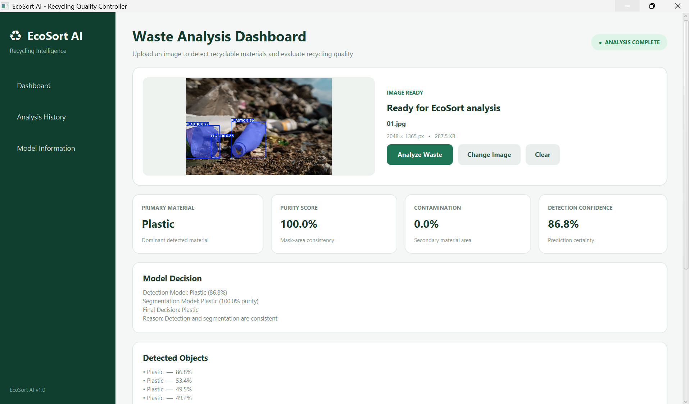
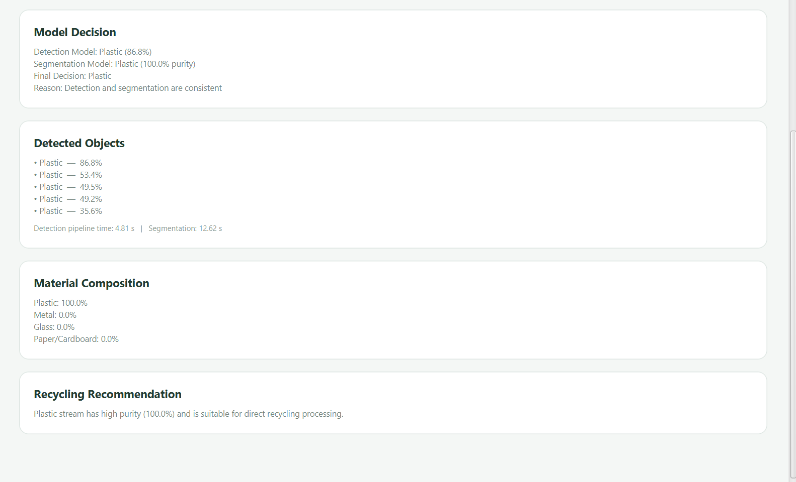

# ♻️ EcoSort AI

### Deep Learning Based Waste Detection, Segmentation and Recycling Quality Analysis

EcoSort AI is a deep-learning application for analyzing recyclable waste from images. It combines object detection and instance segmentation to identify recyclable materials, estimate material composition, calculate purity and contamination, and provide recycling recommendations through a JavaFX desktop application.

The current system supports four recyclable material classes:

**Plastic • Metal • Glass • Paper/Cardboard**

---

## 🖥️ Application

EcoSort provides a JavaFX interface where users can upload a waste image and view the results of the detection and segmentation pipeline.

<p align="center">
  
</p>

The application displays the final material decision only after the detection and segmentation stages have been evaluated.

<p align="center">
  
</p>

The interface reports:

- detected waste objects
- detection confidence
- primary material
- material composition
- purity score
- contamination percentage
- model decision
- recycling recommendation
- inference time
- analysis history

---

## 🧠 System Architecture

<p align="center">
  
</p>

```text
Waste Image
     │
     ├──────────────────────────┐
     ▼                          ▼
YOLO11s Detector          YOLO11s-seg
960 × 960                 640 × 640
     │                          │
Bounding Boxes              Instance Masks
Class Predictions           Material Areas
Confidence                       │
     │                          │
     └─────────────┬────────────┘
                   ▼
            Decision Fusion
                   │
        ┌──────────┴──────────┐
        ▼                     ▼
 Models Agree          Uncertain / Disagree
        │                     │
        ▼                     ▼
Material Result          MANUAL REVIEW
        │
        ▼
JavaFX Application
        │
        ├── Purity
        ├── Contamination
        ├── Composition
        ├── Recommendation
        └── Analysis History
```

Python and Ultralytics handle model inference, while Java manages the desktop interface, analysis workflow and history. Communication between the Java and Python components is JSON-based.

---

## ✨ Main Features

- YOLO11s object detection
- YOLO11s-seg instance segmentation
- semantic material maps derived from segmentation masks
- four recyclable material classes
- material composition estimation
- purity and contamination calculation
- detection confidence reporting
- cross-model decision verification
- Manual Review for uncertain predictions
- JavaFX graphical interface
- persistent analysis history
- robustness and error analysis
- Java deep-learning fundamentals module
- LSTM sequence modelling demonstration
- VAE latent-space demonstration

---

## 🗂️ Dataset

The prepared EcoSort dataset contains **1,407 images** and **3,414 annotated waste instances**.

| Split | Images |
|---|---:|
| Training | 976 |
| Validation | 212 |
| Test | 219 |
| **Total** | **1,407** |

The held-out test set contains **219 images and 488 annotated instances**.

### Material Classes

```text
0 → PLASTIC
1 → METAL
2 → GLASS
3 → PAPER_CARDBOARD
```

Dataset preparation includes utilities for:

- dataset auditing
- duplicate checking
- near-duplicate checking
- train/validation/test splitting
- stratified splitting
- YOLO annotation verification
- segmentation label verification

---

## 🎯 Object Detection

The final detection model is:

**YOLO11s @ 960 × 960**

### Test Performance

| Metric | Result |
|---|---:|
| Precision | **47.8%** |
| Recall | **30.1%** |
| mAP@50 | **26.6%** |
| mAP@50–95 | **20.2%** |
| CPU inference | **~760.5 ms/image** |
| Throughput | **~1.29 FPS** |

### Per-Class Detection

| Material | mAP@50 | mAP@50–95 |
|---|---:|---:|
| Plastic | 31.9% | 23.7% |
| Metal | **45.9%** | **36.9%** |
| Glass | 1.08% | 0.82% |
| Paper/Cardboard | 27.5% | 19.4% |

---

## 🔬 Detection Baseline Comparison

A smaller YOLO11n model was retained as a baseline.

| Model | Precision | Recall | mAP@50 | mAP@50–95 |
|---|---:|---:|---:|---:|
| YOLO11n @ 640 | 38.48% | **34.22%** | **30.59%** | 19.41% |
| YOLO11s @ 960 | **47.8%** | 30.1% | 26.6% | **20.2%** |

YOLO11s improved precision and mAP@50–95, while YOLO11n produced higher recall and mAP@50. The comparison therefore shows a trade-off between the two configurations.

---

## 🖼️ Instance Segmentation

The final segmentation model is:

**YOLO11s-seg @ 640 × 640**

| Metric | Result |
|---|---:|
| Mask Precision | **32.4%** |
| Mask Recall | **32.4%** |
| Mask mAP@50 | **21.0%** |
| Mask mAP@50–95 | **14.5%** |

Instance masks are used to determine how much image area belongs to each predicted material.

---

## 🗺️ Semantic Segmentation

EcoSort also produces class-wise semantic material maps by merging instance masks belonging to the same material class.

This provides a per-pixel representation of:

- Plastic
- Metal
- Glass
- Paper/Cardboard
- Background

---

## 📐 IoU Evaluation

Segmentation was evaluated on all **219 held-out test images**.

| Material | IoU |
|---|---:|
| Plastic | **46.98%** |
| Metal | **45.53%** |
| Glass | 3.37% |
| Paper/Cardboard | 19.82% |

### Overall Segmentation Results

| Metric | Result |
|---|---:|
| Mean Class IoU | **28.92%** |
| Global IoU | **39.71%** |
| Mean Image IoU | **37.47%** |
| Evaluation runtime | **483.96 ms/image** |
| Evaluation throughput | **2.07 FPS** |

---

## ♻️ Purity and Contamination

Material purity is calculated from segmentation-mask area.

```text
         Dominant Material Area
Purity = ────────────────────── × 100
          Total Material Area
```

```text
Contamination = 100 − Purity
```

For example, if Paper/Cardboard occupies most of the predicted material area, it becomes the dominant material and the remaining material area contributes to contamination.

---

## 🛡️ Cross-Model Decision System

Detection and segmentation are separate models and may occasionally disagree.

EcoSort therefore evaluates both outputs before displaying the final Primary Material.

### Normal Case

```text
Detection → Plastic
Segmentation → Plastic
Final Decision → Plastic
```

### Conflicting Case

```text
Detection → Metal
Segmentation → Glass
Final Decision → MANUAL REVIEW
```

### Unsupported / Uncertain Case

```text
Detection → Low-confidence known class
Segmentation → No reliable supported region
Final Decision → MANUAL REVIEW
```

Manual Review can be triggered when:

- detection confidence is insufficient
- segmentation does not identify a supported region
- detection and segmentation disagree
- the image is visually ambiguous

**MANUAL REVIEW is not a fifth trained material class.**

---

## 🧠 Deep Learning Fundamentals

The Java portion of the project also contains implementations and experiments for core deep-learning concepts.

### Neural Networks

- McCulloch-Pitts neuron
- sigmoid neuron
- multilayer perceptron
- forward propagation
- backpropagation
- loss computation

### Mathematical Foundations

- tensor creation and operations
- broadcasting
- inner products
- reshaping
- matrix multiplication
- transpose
- 3D tensors
- Singular Value Decomposition
- numerical gradient checking

### Optimization

- Batch Gradient Descent
- Stochastic Gradient Descent
- Momentum
- Nesterov optimization
- weight initialization
- normalization
- L1/L2 regularization
- dropout

### Learning Rules

- Hebbian learning
- modified Hebbian learning
- competitive learning
- error-correction learning
- Boltzmann / energy-based learning

### Convolution

- 2D convolution
- multi-channel / 3D convolution demonstrations

---

## 🔁 LSTM Sequence Modelling

EcoSort includes a `WasteStreamLSTM` demonstration for temporal waste-composition modelling.

The module demonstrates:

- sequential input processing
- hidden states
- cell states
- temporal representation of waste streams

---

## 🧬 Variational Autoencoder

A Java VAE module is included for latent-space modelling of waste-composition profiles.

The implementation demonstrates:

- latent mean
- log variance
- reparameterized sampling
- reconstruction
- reconstruction loss
- KL divergence
- total VAE loss
- two-dimensional latent coordinates

The latent coordinates can be used to visualize how different waste-composition profiles are organized in latent space.

---

## 🧪 Robustness Testing

EcoSort was tested using **10 additional real-world images** outside the normal test evaluation.

The images included:

- clear recyclable objects
- multiple objects
- mixed waste
- cluttered backgrounds
- small waste objects
- difficult scenes
- unsupported food waste

The experiment showed both correct predictions and failure cases.

These results were also used to improve the application's Manual Review logic.

---

## ⚠️ Limitations

The current model supports only:

- Plastic
- Metal
- Glass
- Paper/Cardboard

It is not trained to reliably recognize every type of waste.

Examples outside the current scope include:

- food / organic waste
- textiles
- electronic waste
- batteries
- wood
- other miscellaneous materials

Glass is currently the weakest trained class.

Performance may also decrease for:

- very small objects
- severe occlusion
- clutter
- transparent objects
- unusual lighting
- highly mixed waste scenes

---

## 📁 Project Structure

```text
EcoSort-AI/
│
├── configs/
│
├── docs/
│   └── images/
│
├── experiments/
│   ├── EcoSort_Training_Experiments.ipynb
│   └── baseline_yolo11n_640/
│
├── java/
│   └── ecosort-core/
│       ├── pom.xml
│       └── src/
│
├── src/
│   ├── ecosort_inference.py
│   ├── ecosort_segmentation_inference.py
│   ├── ecosort_semantic_segmentation.py
│   ├── evaluate_segmentation_iou.py
│   ├── evaluate_robustness.py
│   ├── dataset_audit.py
│   ├── check_duplicates.py
│   ├── check_near_duplicates.py
│   └── ...
│
├── requirements.txt
└── README.md
```

Datasets, trained model weights, virtual environments and generated result folders are excluded from the repository because of their size.

---

## 🚀 Running the Project

### Clone the repository

```bash
git clone <repository-url>
cd EcoSort-AI
```

### Create a Python environment

```powershell
python -m venv .venv
.\.venv\Scripts\Activate.ps1
```

### Install dependencies

```powershell
pip install -r requirements.txt
```

### Add model weights

Place the trained detection and segmentation weights in:

```text
weights/
```

Model weights are not included in the GitHub repository.

### Start EcoSort

```powershell
cd java\ecosort-core
mvn javafx:run
```

---

## ✅ Testing

Run the Java test suite:

```powershell
mvn clean test
```

Current test result:

```text
Tests run: 18
Failures: 0
Errors: 0

BUILD SUCCESS
```

Run the syllabus demonstration:

```powershell
mvn exec:java "-Dexec.mainClass=com.ecosort.SyllabusDemoRunner"
```

---

## 📚 Documentation

The project documentation includes:

- Technical Report
- Final Metrics and Experiment Evidence
- Model Card
- Dataset Card
- User Guide
- Experiment and AI-Use Log
- robustness and evaluation outputs

---

## 🔮 Future Work

Future improvements include:

- adding more Glass training examples
- improving class balance
- collecting more difficult real-world images
- adding additional waste categories
- improving detection recall
- adding explicit unknown-material recognition
- optimizing inference speed
- real-time camera/video analysis
- edge-device deployment

---

## Project Summary

EcoSort AI provides an end-to-end pipeline for:

```text
Waste Image
    ↓
Object Detection
    ↓
Instance / Semantic Segmentation
    ↓
Material Composition
    ↓
Purity & Contamination
    ↓
Cross-Model Verification
    ↓
Recycling Recommendation
```

The project combines deep-learning experimentation with a working Java application for recyclable-material analysis.